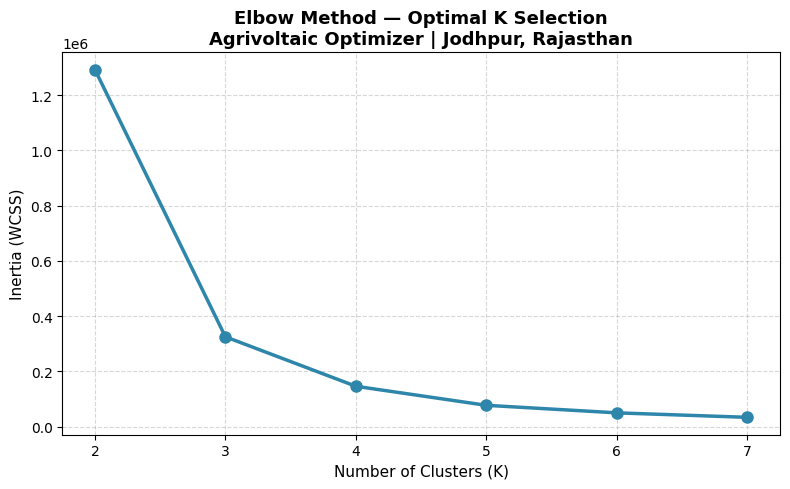

<div align="center">

# ☀️🌾 Agrivoltaic Site Optimizer — Jodhpur, Rajasthan

**Where in Jodhpur district can solar panels and crops share the same land?**
Multi-criteria suitability scoring over 47.6 million pixels, K-means zoning, GPU-accelerated on PyTorch/CUDA.

[](agrivoltaic_optimizer.ipynb)
[](#%EF%B8%8F-mcda-weight-matrix)


</div>

---

## 📊 Key results

| | Result |
|---|---|
| 🧮 **Pixels analysed** | **47,593,250** across the district |
| 🌾 Agricultural pixels | 17,041,548 (35.8%) |
| 🏆 **Prime agrivoltaic zone (Class 5)** | **~3,265 km²** |
| 📈 MCDA score range | 0.60 – 0.70 |
| 🧩 K-means clusters | 5 (elbow at K = 3; K = 5 chosen to align with the five suitability tiers) |
| ⚡ Compute | NVIDIA RTX 5060 · CUDA 12.8 · PyTorch 2.11 |

## 🔍 What it does

- **Agricultural land only** — a LULC mask restricts scoring to cropland, so the result is co-location, not land conversion.
- **Six weighted criteria** — land use, irradiance, grid and road distance, slope and aspect, normalised and combined into one score.
- **Five suitability tiers** — percentile classes turn the continuous score into zones a planner can read.
- **Zoning by clustering** — K-means groups pixels with similar criterion profiles, cross-checked against the tiers.
- **Full district, fast** — raster maths runs as PyTorch tensors on the GPU, with a CPU fallback.

## ⚖️ MCDA weight matrix

| Criterion | Weight | Rationale |
|-----------|--------|-----------|
| Land Use / Land Cover (LULC) | 30% | Identifies agricultural land eligible for agrivoltaic co-location |
| Global Horizontal Irradiance (GHI) | 25% | Solar energy potential — primary driver of PV output |
| Grid Distance | 20% | Proximity to existing power grid reduces infrastructure cost |
| Road Distance | 10% | Accessibility for installation and maintenance |
| Slope | 10% | Terrain suitability for panel installation |
| Aspect | 5% | South-facing orientation preference for solar efficiency |

## 🛰️ Data

**SRTM** DEM (slope, aspect) · **Sentinel-2** land-cover classification · **NASA POWER / PVGIS** irradiance · **OpenStreetMap** transmission lines and roads · Jodhpur district boundary

## 📈 Choosing K



## 🚀 Run it yourself

```bash
python -m venv .venv
source .venv/bin/activate            # Windows: .venv\Scripts\activate
pip install -r requirements.txt
```

Put the input rasters and boundary shapefile in `data/raw/`, open `agrivoltaic_optimizer.ipynb` and run all cells in order. A CUDA GPU is recommended; the CPU path works but is slower.

<details>
<summary><b>Notebook, cell by cell</b></summary>

| Cell | What it does |
|---|---|
| 1 | Environment check (PyTorch, GeoPandas, Rasterio) |
| 2 | MCDA weight matrix definition and validation |
| 3 | File path configuration |
| 4 | Raster alignment check (CRS, resolution, bounds) |
| 5 | Resampling and alignment to the reference grid |
| 6 | LULC agricultural mask |
| 7 | Min–max normalisation of all layers |
| 8 | Weighted MCDA composite score |
| 9 | Percentile-based suitability classes (5 tiers) |
| 10 | K-means clustering (elbow over K = 2–7, final K = 5) |
| 11 | Results summary and outputs |

</details>

<details>
<summary><b>Inputs and outputs</b></summary>

| Input layer | Source | Format |
|-------|--------|--------|
| DEM | SRTM | `.tif` |
| Slope, Aspect | Derived from DEM | `.tif` |
| LULC | Sentinel-2 classification | `.tif` |
| GHI | NASA POWER / PVGIS | `.tif` |
| Grid distance | OSM transmission lines | `.tif` |
| Road distance | OSM road network | `.tif` |
| AOI boundary | Jodhpur District | `.shp` |

| Output | Description |
|------|-------------|
| `agrivoltaic_suitability.tif` | MCDA suitability raster (5 classes) |
| `cluster_output.tif` | K-means cluster raster (5 clusters) |
| `elbow_chart.png` | Elbow plot for choosing K |

</details>

<details>
<summary><b>Folder layout</b></summary>

```
agrivoltaic_optimizer.ipynb   full 11-cell pipeline
data/raw/                     input rasters and shapefile (not in Git)
data/output/                  created by the notebook
docs/                         figures for this README
requirements.txt
```

</details>

## ⚠️ Limitations

The weights are expert-assigned, not fitted or tested for sensitivity, so the ranking of Class 5 land depends on them. Input rasters are not in the repository, so results cannot be regenerated from a fresh clone. Suitability is a screening layer; it does not account for land tenure, water or crop-shade tolerance.

## 👥 Team

SpatioFarm · Semester 2 project, Indian Institute of Remote Sensing (IIRS-ISRO), Dehradun · M.Sc. Agriculture Analytics (DAU · AAU · IIRS-ISRO)

| Member | Links |
|---|---|
| **Sathwik Ramaka** — ML and spatial analysis | [LinkedIn](https://www.linkedin.com/in/sathwik-ramaka-1ba40227a/) · [GitHub](https://github.com/sathwikramaka) |
| **Himanshu Bhanja** | [LinkedIn](https://www.linkedin.com/in/himanshu-bhanja-70362a2bb/) |
| **Swathi A Patil** | [LinkedIn](https://www.linkedin.com/in/swathi-a-patil-69462b3b1/) · [GitHub](https://github.com/swathipatil-analytics) |
| **Kadiri Yaswanthi** | [LinkedIn](https://www.linkedin.com/in/kadiri-yaswanthi-9a632b204/) · [GitHub](https://github.com/YASWANTHI2410) |

<sub>MIT licence</sub>
